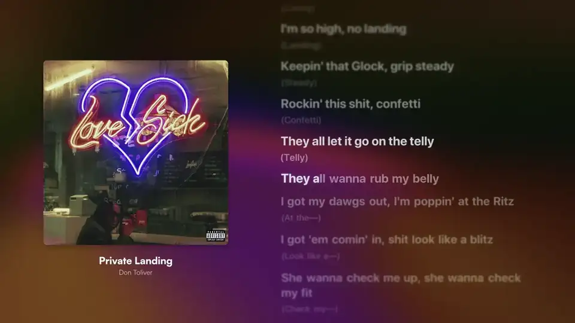

# Spicy for YouTube Music

A [Better Lyrics](https://github.com/better-lyrics/better-lyrics) theme that brings the [Spicy Lyrics](https://github.com/Spikerko/spicy-lyrics) look to YouTube Music.

See [DESCRIPTION.md](DESCRIPTION.md) for the full feature list.

## Install

- **From the store:** Better Lyrics options, **Themes**, **Browse Themes**, then search for "Spicy".
- **From this repo:** Better Lyrics options, **Themes**, **Install from URL**, then paste this repository's URL.
- **By hand:** Better Lyrics, **Edit CSS**, **Import from file**, then pick `style.css`. For the matching background, import `shader.json` in the Better Lyrics Shaders popup.

## Tuning

Open `style.css` and edit the **Tunables** block at the top:

- `$spicy-glass-style`: `liquid` (default, glossy specular), `frosted` (matte dark frost), or `lite` (no backdrop blur, fastest GPU path);
- `$spicy-scroll-fade`: `false` (default, disables mask fade passes on the side panel, queue chips, and related carousels) or `true`;
- `$spicy-bg-motion`: `false` (default, static CSS cover backdrop when Better Lyrics Shaders is off) or `true`;
- `$spicy-canvas-immersive`: `false` (default, avoids `26` fullscreen `:has(#bls-video...)` rules and animated-stage dock overrides in Chromium) or `true`;
- `$spicy-distance-blur`: `true` (default, progressive blur and sibling focus) or `false` (opacity-only dimming with zero blur `RenderSurface`s);
- `$spicy-style-browse`: `true` (default, browse/home pages, nav bar, sidebar animations, and popups) or `false`;
- `$spicy-style-side-tabs`: `true` (default, side-panel tab bar, Queue, and Related tabs) or `false`.

## License

This project is licensed under the GNU Affero General Public License v3.0 - see the [LICENSE](LICENSE) file for details.
